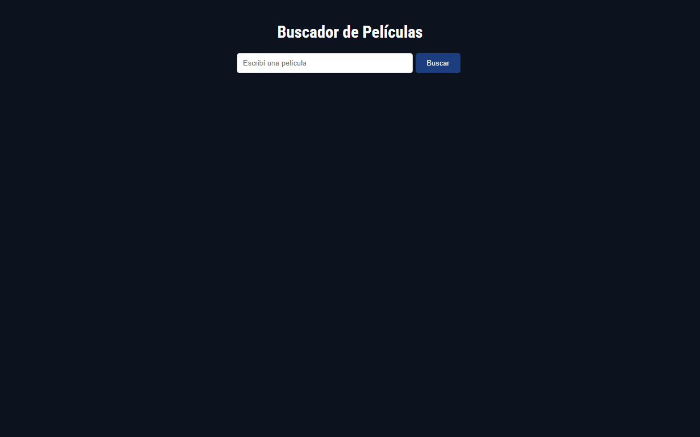
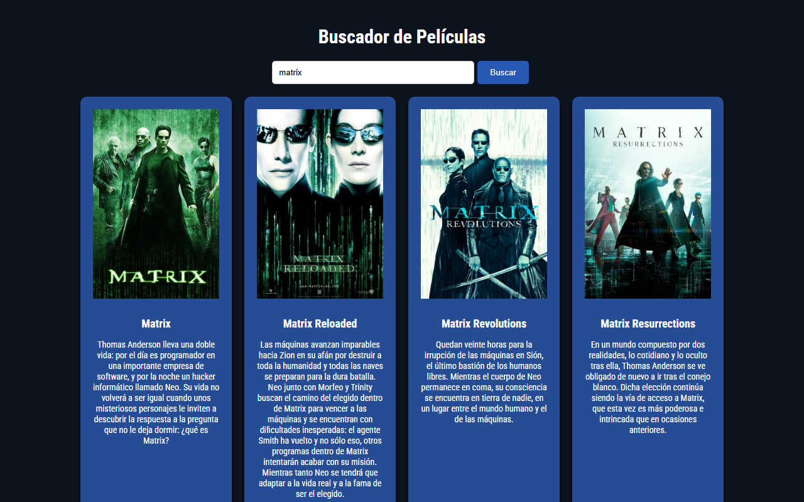

# Buscador de Películas · React

Buscador de películas con The Movie Database (TMDB): escribís un título y la app muestra un listado de tarjetas con póster, nombre y sinopsis en español.

Proyecto de práctica construido con **React 19 + Vite** y CSS propio.


## Contenido

- [Capturas](#capturas)
- [Características](#características)
- [Stack](#stack)
- [Estructura del repositorio](#estructura-del-repositorio)
- [Requisitos](#requisitos)
- [Puesta en marcha](#puesta-en-marcha)
- [Configuración](#configuración)
- [Despliegue](#despliegue)

## Capturas

| Buscador | Resultados |
| :------: | :--------: |
|  |  |

## Características

- Búsqueda por título usando el endpoint `/search/movie` de TMDB.
- Resultados en español (`language=es-ES`).
- Tarjetas con póster (`image.tmdb.org/t/p/w500`), título y sinopsis.
- Formulario controlado con `useState` y manejo de errores en la petición.
- Diseño responsive en grilla, con CSS propio.

## Stack

| Capa | Tecnologías |
| --- | --- |
| Frontend | React 19 · React DOM 19 · JavaScript (ESM) |
| API | The Movie Database (TMDB) REST API |
| Build | Vite 7 (paquete `rolldown-vite`) |
| Estilos | CSS3 nativo (`MovieApp.css`, `index.css`) |
| Calidad | ESLint 9 con hooks de React y react-refresh |

## Estructura del repositorio

```text
aplicacion-peliculas-reactjs/
├── src/
│   ├── main.jsx          # Punto de entrada de React
│   ├── MovieApp.jsx      # Formulario, fetch y grilla de resultados
│   ├── MovieApp.css
│   └── index.css
├── index.html
├── vite.config.js
├── eslint.config.js
└── package.json
```

## Requisitos

- Node.js 18 o superior y npm.
- Conexión a internet para consultar TMDB.

## Puesta en marcha

```bash
npm install
npm run dev
```

Abrí <http://localhost:5173>, escribí por ejemplo `matrix` y tocá **Buscar**.

```bash
npm run lint    # ESLint
npm run build   # build de producción en dist/
npm run preview # sirve el build localmente
```

## Configuración

La API key está al inicio de `src/MovieApp.jsx`:

```js
const urlBase = 'https://api.themoviedb.org/3/search/movie'
const API_KEY = 'tu-api-key'
```

Para publicar el proyecto conviene usar una variable de entorno (`VITE_TMDB_API_KEY`) en lugar de dejar la key en el código fuente.

## Despliegue

Es un sitio estático: el comando de build es `npm run build` y el directorio a publicar es `dist/`. Funciona en Netlify, Vercel, Cloudflare Pages o GitHub Pages.
